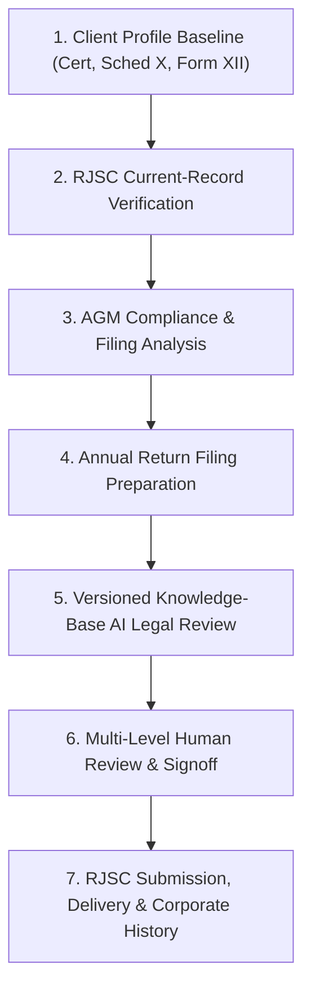

# ZA Corporate Desk — Legal Workflow Specification (Bangladesh RJSC)

**Standard Legal Reference**: The Companies Act, 1994 (Act No. XVIII of 1994), The Stamp Act 1899, The Societies Registration Act 1860, RJSC Public Notifications & Citizen Charters, and ICAB Document Verification System (DVS) Guidelines.

---

## 1. Statutory Foundations & Primary Law Mapping

The legal workflow of ZA Corporate Desk is built strictly upon primary Bangladesh corporate statutes:

### 1.1 Annual Return Filing Document Mapping (Sections 36, 185, 210)
Under Section 36 of the Companies Act 1994, an Annual Return consists of four distinct statutory components, each with its own trigger and legal deadline:

| Document | Statutory Basis | Mandatory for Annual Return? | Individual Statutory Trigger | Applicable Deadline | Legal Exception / Role |
|:---|:---|:---:|:---|:---|:---|
| **Schedule X (Annual Return)** | Companies Act 1994, **Sec 36(1)** | **YES** | Holding of the Annual General Meeting (AGM) | **21 calendar days** immediately after AGM | Mandatory list of members, capital summary, and director particulars as of AGM date. |
| **Balance Sheet** | Companies Act 1994, **Sec 185, 186, 190** | **YES** (Pvt Ltd) | Adoption at AGM by shareholders | Laid before AGM; filed with Schedule X | Financial position audited by qualified chartered accountants; certified by Directors. |
| **Profit & Loss Account** | Companies Act 1994, **Sec 185, 186, 190** | **YES** (Pvt Ltd) | Adoption at AGM by shareholders | Laid before AGM; filed with Schedule X | Financial results for period ending on balance sheet date. |
| **Form 23B (Auditor Consent)** | Companies Act 1994, **Sec 210(2)** | **YES** | Appointment / reappointment of auditor at AGM | **30 calendar days** from date of appointment | Written consent of statutory auditor to act. Filed independently or alongside return. |
| **Form XII (Return of Directors)** | Companies Act 1994, **Sec 115** | **NO** (Conditional Only) | Appointment, cessation, or change in particulars of Directors | **14 calendar days** from date of change / incorporation | **STRICTLY CONDITIONAL**: Form XII is **NOT** a routine part of an Annual Return. Only required if a directorship change occurred during the period or upon specific regularization demand. |

### 1.2 AGM Requirements & Statutory Extensions (Section 81)
- **First AGM**: Must be held within **18 months** from the date of incorporation.
- **Subsequent AGMs**: Must be held once in every calendar year and not more than **15 months** after the holding of the previous AGM.
- **Registrar Extension**: The Registrar may, on lawful application, extend the time for holding any AGM (other than the first) by not more than **90 days** in ordinary circumstances, or under Section 81(1) by up to **3 years** upon showing of sufficient cause.
- **Evidentiary Principle**: An AGM date cannot be inferred from a fiscal year string (*e.g. 2022-2023*), an audit report date, or a DVC issuance date. Missing evidence of an AGM must never be automatically treated as proof that an AGM did not take place.

### 1.3 Audit Verification & ICAB Document Verification System (DVS)
- Audit reports must be authenticated with an official **DVC Code** issued under ICAB regulations.
- DVC proves the authenticity and registration of the statutory audit report; it does **not** prove that an AGM was held or when it took place.

### 1.4 Share Transfer Requirements (Section 38 & The Stamp Act 1899)
- Instrument of transfer (Form 117) executed on non-judicial stamp paper bearing requisite ad valorem stamp duty under The Stamp Act 1899 (Schedule 1, Article 62) by both Transferor and Transferee.
- Board of Directors must formally resolve and approve the transfer.
- Direct update of the Shareholder Register (Section 34) occurs **only after** Board Approval and execution.

### 1.5 Mortgage & Charge Registration (Sections 159 & 171)
- Form XVIII must be registered with RJSC within **21 calendar days** after the date of instrument creation (Section 159).
- After 21 days, registration is strictly barred unless condoned by the **High Court Division** under Section 171.
- Modification: Form XIX.
- Satisfaction: Form XXVIII within 21 days of full payment/settlement.

---

## 2. Seven Distinct Workflow Stages

To ensure legal integrity and operational compliance, the system separates the workflow into seven distinct stages:

### Stage 1 — Client Profile & Foundational Baseline
- **Foundational Documents**:
  1. **Certificate of Incorporation** (Section 24).
  2. **Schedule X** (Section 36).
  3. **Form XII** (Section 115).
  *(Note: MOA/AOA may be uploaded as supporting documents, but are not mandatory onboarding gates without explicit approval).*
- **Verification**: Evaluates presence and verification status of the three foundational documents.

### Stage 2 — RJSC Current-Record Verification
- **Objective**: Verify the public record position on the RJSC portal before drafting filings.
- **Evidence Sources**: Official RJSC portal screenshot and certified-copy document list.
- **Strict Evidence Rules**:
  - A verified screenshot establishes only what is explicitly visible.
  - Document date on an RJSC certified-copy list is the document date, **not** the RJSC filing date.
  - Do not infer unshown periods or submission dates.

### Stage 3 — AGM Compliance & Filing Analysis
- **Objective**: Evaluate financial years against Section 81 and Section 36 requirements.
- **Statuses**:
  - `FILED & VERIFIED`: Backed by reviewed official RJSC acknowledgment reference (*e.g. AR-*, *RJSC-*, *ACK-*) or verified document with provenance.
  - `PENDING`: AGM held, within 21-day statutory window.
  - `OVERDUE`: 21-day deadline passed. Statutory late fee returns `REVIEW_REQUIRED` (unapproved penalty formulas strictly barred).
  - `EVIDENCE_UNCERTAIN`: Lacks signed AGM minutes or verified portal record.

### Stage 4 — Annual Return Filing Preparation
- **Document Assembly**:
  - Mandatory: Schedule X + Audited Balance Sheet + Audited Profit & Loss Account + Form 23B.
  - Form XII is **excluded** unless director appointments, resignations, or changes occurred during that period.

### Stage 5 — Versioned Knowledge-Base AI Legal Review
- **Architecture**:
  - Rather than inserting section numbers into generic LLM prompts, the system maintains a versioned, source-backed **Legal Knowledge Base** containing:
    - Primary Companies Act 1994 provisions and Gazette amendments.
    - Statutory deadlines, effective dates, and applicability rules.
    - Human-reviewed legal citations and ICAB/RJSC circulars.
  - AI review queries this knowledge base and produces structured compliance preflight with citations.
  - AI recommendations are advisory and cannot alter records.

### Stage 6 — Multi-Level Human Review & Signoff
- **Hierarchy**:
  1. `JUNIOR`: Working paper preparation and checklist verification.
  2. `SENIOR`: Compliance audit, DVC verification, and query return.
  3. `MANAGER` / `ADMIN`: Final authorization (`APPROVED_FOR_PORTAL_UPLOAD`).
- **Authorization Gates**:
  - Only `ADMIN` and `MANAGER` can approve Share Transfers to update shareholder registers.
  - Only `ADMIN` and `MANAGER` can commit Mortgage & Charge records into Client Master.

### Stage 7 — RJSC Submission, Delivery & Corporate History
- **Manual Submission Tracking**: Records tracking number, submission date, challan fee, and upload timestamp.
- **Query & Resubmission**: Tracks official RJSC queries, deadlines, and corrective actions.
- **Corporate History Update**: Automatically writes completed filing to client history with provenance link.
- **Financial Separation**: Operational completion is strictly separated from invoice billing and collections.
